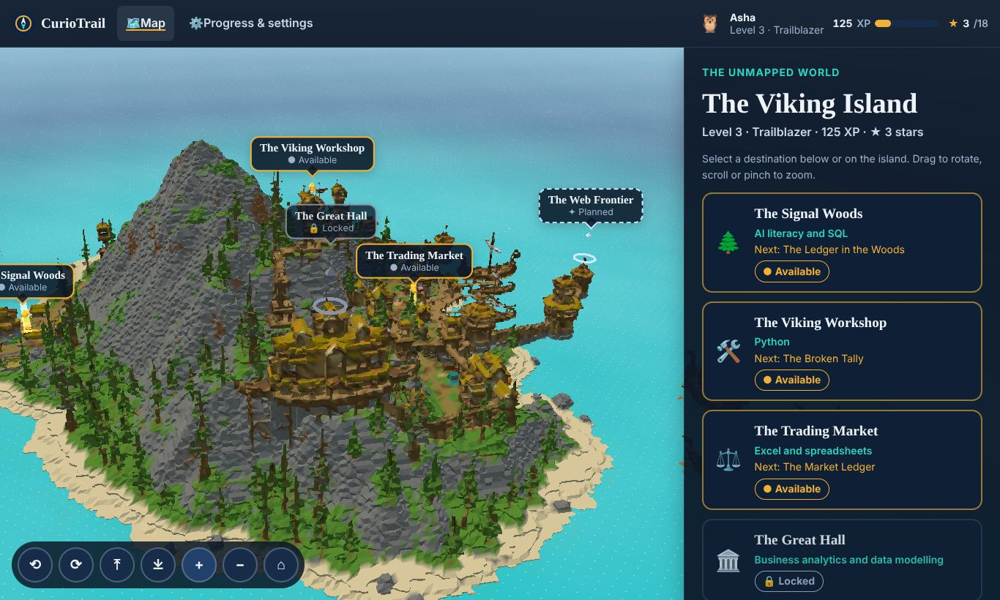

# CurioTrail

**Find your way through the digital world.**

CurioTrail is a free, open-source, story-driven 3D learning game. You become a *Pathfinder* on a Viking island, and each destination on the island teaches a practical digital skill through short quests: checking AI-generated information, querying data with SQL, repairing Python, building spreadsheet formulas and reading business KPIs.

> **Status:** playable prototype. Six quests are complete from start to finish, including a hands-on data-modelling lab, each with theory cards. They're organised into an eight-module learning path; modules with no content yet are clearly marked *planned*. No unfinished feature is presented as working.
> "CurioTrail" is a working name. Trademarks and domains have not been checked.

**Play:** https://denilthaks.github.io/CURIO/ (once `main` is deployed; see [Deploy](#deploy)).



## What's in the game

| Destination (on the island) | Quest | Skill | Challenge types |
|---|---|---|---|
| 🌲 The Signal Woods (forest hamlet) | 01 The Missing Signal | AI literacy | Evidence inspection, choices, prompt choice, announcement assembly |
| 🌲 The Signal Woods | 02 The Ledger in the Woods | SQL | Real SQLite queries: `WHERE`, `GROUP BY` + `SUM`, `ORDER BY` + `LIMIT` |
| 🛠️ The Viking Workshop | 03 The Broken Tally | Python | Read a real `TypeError`, fix it, write expressions, predict output |
| ⚖️ The Trading Market (harbour) | 04 The Market Ledger | Excel | Cell addresses, `=B2*C2` with fill-down, `SUM`, `AVERAGE`, `$` references |
| 🏛️ The Great Hall (longhouse) | 05 The Jarl's Dashboard | Business analytics | Drag KPI cards into a dashboard, interpret trade-offs, choose a chart |
| 🏛️ The Great Hall | 06 The Star Chart (lab) | Data modelling | Build a star schema: add tables, connect keys, set cardinality and direction; the model is checked by real rules |
| 🧭 The Web Frontier (pier tower) | Planned | Digital tools | Not playable yet |

**Unlocking:** The Missing Signal opens the Workshop and the Market. The SQL quest follows it in the Signal Woods. The Market Ledger opens the Great Hall. The Star Chart also requires the SQL quest. All of this is driven by `public/data/world.json` and each quest's `requires`.

**Learning cycle:** each quest moves through **Learn → Guided exercise → Practice → Check your understanding**, shown as colour-coded badges.
- **Theory cards** teach each concept before it's practised. Each card has an objective, a plain-English explanation, an analogy, an example, why it matters, a common mistake and a takeaway, and states any simplification.
- On a replay, a lesson opens in its short version, so experienced learners aren't made to re-read it.
- Lessons award no XP, because XP is for demonstrated skill.

**Learning path:** eight modules, from 0 Digital Foundations to 7 Analytics and Projects (see *Progress & settings*). Modules 0, 1 and 5 have playable content; modules 2, 3, 4, 6 and 7 are listed as planned, with their topics.

**Scoring:**
- Each challenge gives XP, plus a first-try bonus.
- Wrong answers give the feedback written for that answer and progressively stronger hints.
- After three tries the player can reveal the answer. That step then earns no XP.
- Stars per quest: ★★★ = all first try, ★★ = no reveals, ★ = finished with help.
- Replays keep your **best** score, so rewards are never counted twice.
- The results screen reports each skill as *demonstrated first time*, *after a hint*, or *reviewed with help*.

## Architecture

```
Quest data (JSON) → game rules (src/engine, pure TS) → player state (progress-store)
                                                     → React UI (src/ui)  +  3D world (src/world)
```

- **`src/engine/`** has no DOM, React or Three.js. It holds:
  - `game-engine.ts`: progression, evaluation of every challenge type, XP, stars, skill report and levels
  - `progress-store.ts`: versioned localStorage save (schema v2 with v1→v2 migration) that validates and clamps all loaded data
  - `progression.ts`: unlock and destination states
  - `quest-validation.ts`: content checks, including running every Python and Excel solution
  - `python-lite.ts`: a sandboxed evaluator for a subset of Python expressions, with CPython-style errors
  - `excel-lite.ts`: a formula evaluator with fill-down
  - `sql-check.ts`: compares query results
  - `schema-lab.ts`: the modelling lab's interaction reducer and its rule-based validator (key uniqueness and foreign-key matching are computed from sample rows)
- **`src/runtime/sql-runner.ts`** runs learners' SQL on a fresh in-memory **SQLite** database (sql.js / WebAssembly, loaded only when needed).
- **`src/world/`** is imperative Three.js. `WorldRenderer` loads the island progressively (light version first, then detailed), places markers by raycasting onto the model, handles camera fly-to transitions, picking, orbit, zoom and keyboard controls, characters, effects, quality tiers, context loss and full disposal. Characters are original low-poly figures with procedural poses.
- **`src/ui/`** contains the React screens:
  - Home (A)
  - Map (B)
  - Quest (C–F)
  - Completion (G)
  - Progress & settings (I)
  - Mobile layouts (H) throughout

  All text is HTML over the canvas. A 2D fallback map is used when WebGL is unavailable, switched off or fails, and every quest still works.

The full audit and implementation plan is in [docs/AUDIT-AND-PLAN.md](docs/AUDIT-AND-PLAN.md).

## Run locally

Requires Node 22+.

```sh
npm ci
npm run dev          # http://localhost:5173 with hot reload
npm test             # 99 unit tests (Vitest)
npm run typecheck
npm run build        # production build in dist/
npm run preview      # serve the build
npm run e2e          # 34 real-browser checks (needs Playwright + Chromium; see below)
```

`npm run e2e` serves `dist/` under `/CURIO/` (like GitHub Pages) and drives Chromium through every quest, the failure modes and the mobile layout. It writes screenshots to `docs/screenshots/` and results to `docs/test-results/e2e.json`. Install Chromium once with `npx playwright install chromium`.

## Deploy

GitHub Pages builds from `main` using `.github/workflows/deploy-pages.yml`: `npm ci`, typecheck, tests, `vite build`, then publishing `dist/`. In the repository's **Settings → Pages**, the source must be **GitHub Actions**. Vite uses a relative base (`./`), so the same build works at `/CURIO/` or any other path. `.github/workflows/test.yml` runs typecheck, tests and the build on every push and pull request.

## Accessibility

- Semantic HTML: radio groups, `fieldset`/`legend`, real buttons and links, and labelled regions for tables and the spreadsheet
- Skip link, visible focus, and focus moved to the new heading on navigation and to the feedback after each answer
- Polite live announcements for changes that don't move focus
- Every 3D interaction has an HTML alternative: the destination list, camera buttons and keyboard shortcuts (Q/E rotate, +/− zoom, R reset), and a select menu for every draggable KPI card
- Settings for text size, motion (follow the device, reduce or allow) and graphics (auto, high, light or off)
- Status is always shown with text and an icon, never colour alone. Mobile touch targets are at least 40px.
- **Not yet done:** testing with real screen readers (NVDA, VoiceOver, TalkBack) and with beginner users.

## Assets and credits

- **3D island:** based on ["Viking Island - Minecraft"](https://sketchfab.com/3d-models/viking-island-minecraft-fd76e3824b7647d98be20d3e2160e018) by [cubical.xyz](https://sketchfab.com/cubical), licensed under [CC-BY-4.0](http://creativecommons.org/licenses/by/4.0/). It was optimised for the web: 376 MB and 4.5M triangles became 0.6 MB (light) and 4.4 MB (detailed). The two model files remain CC-BY-4.0. See [docs/ASSETS.md](docs/ASSETS.md) and `public/models/CREDITS.txt`.
- Everything else is original to this project: code, quest content, characters, sky, water, clouds and markers.
- **Libraries:** React, Three.js, sql.js (SQLite) and Vite, all MIT or a compatible licence.

## Privacy

There are no analytics, cookies or third-party requests. Progress stays in your browser, and clearing your browsing data erases it.

## Known limitations

See [docs/TEST-REPORT.md](docs/TEST-REPORT.md#incomplete-or-limited) for the full, honest list. In short:
- The characters are stylised and procedural, not rigged models.
- Python is a sandboxed *subset* (expressions only).
- The light island looks coarse up close.
- No real phone or GPU has been measured yet.

## Licence

The code and quest content are MIT (see [LICENSE](LICENSE)). The island model files are CC-BY-4.0, as above.

## Feedback

[Open an issue](https://github.com/denilthaks/CURIO/issues/new?title=CurioTrail%20feedback).
