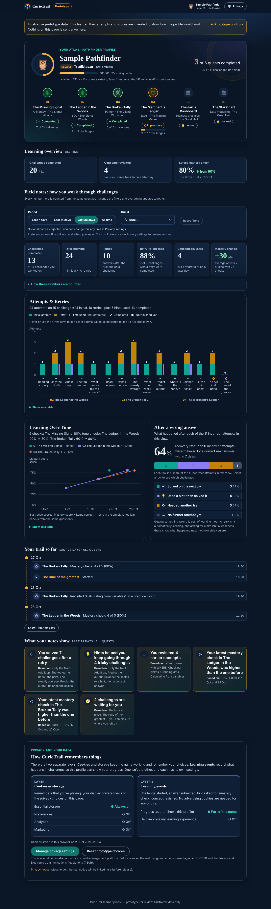

# Learner profile & behaviour analytics — prototype

A standalone, interactive prototype of a redesigned CurioTrail learner profile:
profile header and quest trail, learning overview, a behaviour-analytics
dashboard (three charts and six KPIs), a learning journey timeline, evidence-based
insights, and a cookie / privacy interface.

**Status: prototype for design approval only.** It is not wired into the game,
changes no production file, and every learner figure is **illustrative prototype
data**.



## Run it

No install, no build, no dependencies.

- **Simplest:** open `prototype/profile-analytics/index.html` in a browser
  (works from `file://`).
- **Or serve the repo root:**
  ```sh
  python3 -m http.server 8765 --bind 127.0.0.1
  # then open http://127.0.0.1:8765/prototype/profile-analytics/
  ```

The page loads the real `src/styles/tokens.css`, `base.css` and
`components.css` (read-only, by relative path), so keep the folder inside the
repository.

**Prototype controls** (top of the page) switch between three data scenarios —
the default learner, a learner with zero retries, and a new learner with no
activity — and open the raw event log behind every figure. The prototype's
"today" is fixed at **28 Oct 2026** so periods give reproducible numbers.

## What reuses the existing repository

| From the repo | Used for |
|---|---|
| `src/styles/tokens.css`, `base.css`, `components.css` | All colours, type, spacing, radii, focus ring, buttons, status chips, the parchment settings dialog, reduced-motion handling |
| `public/data/world.json`, `public/data/quests/*.json` | Quest numbers, titles, subjects, destinations, challenge ids/titles, skill ids |
| `src/engine/progression.ts` | Unlock rules, re-implemented in `metrics.js` (*mastered* treated as *completed*) |
| `src/engine/game-engine.ts` `LEVELS` | Level names and thresholds |
| `src/ui/emblems.ts` | The owl emblem |
| `PracticeScreen` (practice rounds count towards concept mastery) | What a "concept revisit" means |

Nothing new was invented for the game: no XP economy, leaderboard, rewards or
achievement rules. The XP value shown is a labelled placeholder; mastery checks
are a labelled placeholder for a per-quest "Check your understanding" review.

No chart library exists in the repo, so the charts are plain HTML + SVG
(~350 lines in `charts.js`), with no new dependency.

## Event data model

One flat, time-ordered log. Every chart, KPI, insight and timeline entry is
computed from it by `metrics.js` (`computeView(data, events, filters)`), so the
numbers cannot disagree.

| `type` | Fields | Meaning |
|---|---|---|
| `challenge_started` | `ts, quest, challenge` | Learner opened a challenge |
| `answer_submitted` | `ts, quest, challenge, correct` | One attempt |
| `hint_requested` | `ts, quest, challenge` | One hint (never an attempt) |
| `mastery_check` | `ts, quest, correctItems, items` | A mastery check and its score |
| `concept_revisited` | `ts, quest, skill, via` | Practice round (`practice`) or lesson re-read (`lesson`) |

"Challenge completed" and "retry" are **derived**, not stored: a challenge is
completed by a correct answer, and a retry is any answer after the first.

The default learner has completed quests 01–03 and is part-way through
04 *The Merchant's Ledger*; because the Great Hall unlocks only after the
Merchant's Ledger, quests 05 and 06 are correctly **locked**. The dataset covers
first-try solves, multiple retries, hints followed by success, a hint followed
by another miss, an unfinished challenge, a started-but-unanswered challenge,
concept revisits on later days and rising and flat mastery scores.

## Metric definitions

| Metric | Formula |
|---|---|
| **Attempt** | One `answer_submitted` event. |
| **Initial attempt** | The first answer ever submitted to a challenge (counted over the whole history, so a period filter never turns a retry into an "initial"). At most one per challenge. |
| **Retry** | Any later answer to the same challenge. **Retries = attempts − initial attempts.** The initial attempt is never a retry. |
| **Hints used** | Count of `hint_requested`. Shown beside, not stacked on, attempts. |
| **Challenges completed** | Challenges with a correct answer in the view. |
| **Retry-to-success rate** | Challenges with ≥ 1 retry in the view that were completed ÷ challenges with ≥ 1 retry in the view. "—" when the denominator is 0. |
| **Recovery outcome** | For each incorrect attempt in the view, the next event on the same challenge within **7 days**: *solved on the next try* (next answer correct, no hint between), *used a hint, then solved it*, *needed another try* (next answer incorrect), or *no further attempt yet*. The four categories partition the incorrect attempts. |
| **Recovery rate** | (solved next try + hint, then solved) ÷ incorrect attempts in the view. |
| **Concept revisited** | A `concept_revisited` event for a skill first met on an **earlier calendar day**. Same-day re-reads don't count. KPI = distinct skills revisited in the view. |
| **Mastery score** | correctItems ÷ items, as a percentage. |
| **Mastery change** | For each quest with ≥ 2 checks in the view: latest − earliest score (percentage points). KPI = mean across those quests. "—" when no quest has two checks in the view. |

Filters: period (last 7 / 14 / 28 days, all time — inclusive calendar days
ending on the prototype clock) and quest. Default: last 28 days, all quests.

Worked example (default view): 24 attempts = 14 initial + 10 retries; 5 hints;
13 of 15 challenges completed; 7 of 8 challenges with a retry completed → 88%;
11 incorrect attempts → 3 solved next, 4 hint-then-solved, 3 another try,
1 no further attempt → recovery 64%; mastery +40 (02) and +20 (03) → +30 pts.

Insights appear only when the view's data supports them (e.g. "You solved 7
challenges after a retry" needs completed challenges with retries) and each one
shows the records it is based on. No insight equates activity with learning,
retries with low ability or hints with weakness.

## Privacy design

Two separate layers, kept separate in the UI and in code:

1. **Cookies & storage** — essential (always on, flagged for legal review of
   what truly counts as essential), preferences, analytics, marketing. Optional
   categories default to **off**; nothing optional is stored before a choice.
2. **Learning events** — the progress record that powers this profile, plus a
   separate optional "Help improve my learning experience" switch (off by
   default). Accepting cookies does **not** turn it on. Turning it off is
   explained as *not* deleting existing records; access, deletion and account
   controls are described separately (with the game's real behaviour: progress
   is saved only in this browser and "Reset all progress" erases it).

Banner: *Reject optional cookies* and *Accept optional cookies* share one
style, size and row; *Customise settings* opens the full panel. The panel stays
reachable from the header and the profile's privacy section. The privacy notice
link is a placeholder.

**Storage used by the prototype** (both cleared by *Reset prototype choices*):

- `curio-proto-consent` — the choices (treated as essential).
- `curio-proto-prefs` — remembered filters, written **only while Preferences is
  on** and deleted when it is turned off. This is the one category with a real
  effect in the prototype.

This is a local demonstration, **not** a consent-management platform. The real
implementation must be reviewed against UK GDPR and PECR before release.

Safeguards in the prototype: local mock data only; a Content-Security-Policy
with `connect-src 'none'`; no third-party scripts, trackers, fonts or
fingerprinting; no real names or email addresses.

## Accessibility

- Every chart mark is a real `<button>`: one tab stop per chart, arrow keys /
  Home / End move between marks, focus and hover show the same tooltip, Enter
  opens the challenge breakdown, Escape closes the tooltip, closing the
  breakdown returns focus to its bar.
- Each chart has a text summary and a "Show as a table" view.
- Identity never relies on colour: legend + symbols (✓ / half-circle) on
  Chart A, distinct marker shapes per quest on Chart B, icons and words on
  Chart C and the journey.
- Chart colours are one step deeper than the UI accents (teal `#0fa596`, amber
  `#c2830c`, violet `#8b7df0`, coral `#d9654c`) and pass a CVD-separation /
  lightness / contrast validator on the night surface. Text pairs checked
  ≥ 5.6:1 (WCAG AA).
- Respects `prefers-reduced-motion` via the repo's own `base.css` rule.
- Filter changes are announced in a live region.

## Files

```
prototype/profile-analytics/
├── index.html          page structure, cookie banner, privacy and event-log dialogs
├── styles.css          prototype-only styles on top of the repo's tokens
├── data.js             ILLUSTRATIVE event log (3 scenarios) + real quest metadata
├── metrics.js          pure functions: every KPI, chart series, journey and insight
├── charts.js           Chart A (HTML columns), Chart B (SVG + HTML markers), Chart C
├── consent.js          local consent state and Preferences-gated storage
├── app.js              wiring: filters, detail panel, journey, insights, dialogs
├── tests/
│   ├── metrics.test.cjs   14 formula tests (Node's built-in runner)
│   └── browser-check.py   53 browser checks + screenshots (Playwright, Chromium)
├── screenshots/        captured from the running prototype
└── README.md
```

## Checks

```sh
# from the repository root
node --test prototype/profile-analytics/tests/metrics.test.cjs
python3 -m http.server 8765 --bind 127.0.0.1 &
python3 prototype/profile-analytics/tests/browser-check.py
```

Last run: **14 / 14** formula tests and **53 / 53** browser checks passed.
They cover: KPI formulas against hand-counted values; retries excluding initial
attempts; chart totals equalling KPIs across every period × quest; every filter
updating KPIs, all three charts and the journey together; reset; tooltips via
focus and hover; keyboard navigation; the breakdown panel; zero-retry,
incomplete, started-only, locked-quest and empty-learner states; banner parity,
consent state, Preferences remembering and forgetting filters, reset; no
console errors; no requests outside the local server; no horizontal overflow at
390 / 768 / 1366 px; reduced motion; and loading from `file://`.

### Not done / limitations

- The repository's own Vitest suite and type-check were **not run**: installing
  its npm dependencies wasn't permitted in the environment used to build this.
  The prototype touches no file they cover.
- Tested in Chromium only; not in Safari, Firefox or with a real screen reader.
- Colour contrast was checked by calculation, not with an audit tool.
- Mastery checks and XP are placeholders. Production would need to record
  events in the format above alongside the existing `progress-store` save;
  how that maps onto the current save schema hasn't been designed yet.
- The consent logic is a demonstration and has had no legal review.
